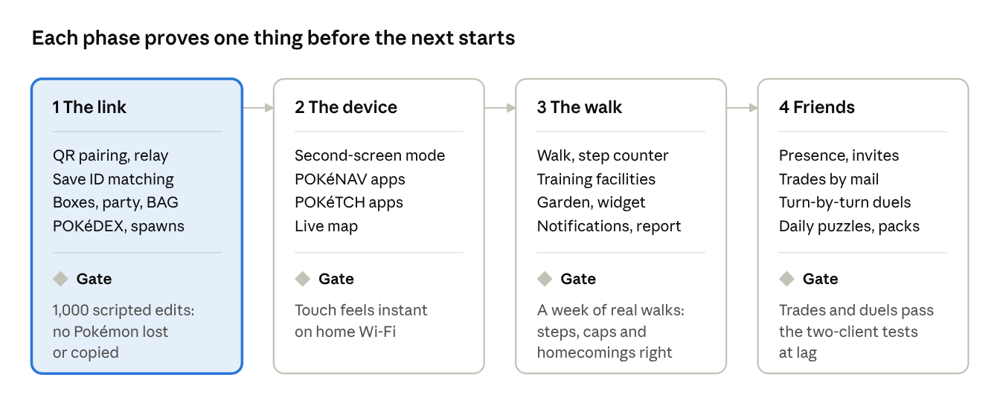

<!-- The user's design for the Moemon Companion App (sent 2026-11-02 as Moemon_Companion_App_Design_Doc.docx),
kept as written. NOT STARTED, ON HOLD: no app (Android) work until the user says "Let's do the app" (the user,
2026-11-02: finish the region work and SINNOH first). -->

# Moemon Companion App: Design Doc

Nov 2, 2026 · \@Christian

## Vision and design pillars

The app takes Moemon Emerald Kai with you. It does what only a phone can
do: it\'s in your pocket, counts your steps, works as a second screen
and can nudge you at the right moment. It always sends you back to the
game with something new, and it never replaces playing.

Four pillars sit on a base of management tools:

-   **The second screen:** the phone takes on the device of the region
    you\'re in (POKéNAV, POKéTCH\...).

-   **The walk:** a Pokémon in your pocket that grows with your real
    steps.

-   **The Garden in your pocket:** your Pokémon\'s lives, nudges and the
    daily report.

-   **Friends:** who\'s playing, invites, trades by mail, duels by turn.

-   **The base:** boxes, party, BAG, POKéDEX, spawns and the three card
    games\' BINDERs.

Rules every feature follows:

1.  **The game is where things happen.** The app prepares, collects and
    shows. Big moments (evolution, hatching, a trade, a homecoming) play
    out in the game.

2.  **One owner at a time.** A Pokémon, item or card is in the game or
    on the phone, never both. That rule is what makes syncing safe.

3.  **No chores.** Nothing from the app is needed to finish or enjoy the
    game. Rewards that build up while you\'re away are capped, so
    skipping a day costs nothing.

4.  **Respect the phone.** Notifications are rare and can be turned off,
    and there are no streaks to lose.

5.  **Same world, same rules.** GENERATION, level scaling, SEALED
    Pokémon, badge caps and the host\'s online rules all apply in the
    app. Online, the host can turn off any of the app\'s features for
    their room in GAME RULES.

6.  **Same look and sound.** The game\'s menus, font, sounds and music,
    made for touch.

## Platform, install and updates

The app is an Android APK. It\'s built by the same release workflow as
the game, carries the game\'s version number and updates itself from
GitHub\'s latest release.

-   **One release, two files:** the release workflow builds the APK next
    to the exe and attaches it to the same v\<ver\> release. The app
    shows the same PATCH NOTES as the game.

-   **Updates:** Android won\'t install updates silently. The app
    downloads the new APK and Android asks \"Install?\". The first
    install needs \"Install unknown apps\" turned on once, so the README
    should show how.

-   **Link version:** the link has its own protocol number, separate
    from the game version (like MP_PROTOCOL_VERSION). A game update that
    doesn\'t touch the link never forces an app update. If the numbers
    differ, the app works offline and offers the update.

-   **Signing key:** one release key, kept as a repository secret and
    backed up. Lose it, and every player has to uninstall and lose what
    the phone holds. That\'s why rule 2 matters: a lost app must never
    mean a lost Pokémon.

-   **Shared code:** the rules (Pokémon data, the card engines, pack
    math, the music engine) are the game\'s own C, built into the app
    with the Android NDK, so the phone and the game always agree. The
    screens are built for touch in a thin native layer, which also
    handles notifications, the step counter and the widget.

-   **Licences:** Yu-Gi-Oh! runs on EDOPro\'s ocgcore (AGPL). Shipping
    it in the APK needs the same source offer the exe has.

An alternative for iPhone users: the game could serve the app itself as
a web page over Wi-Fi.

  -----------------------------------------------------------------------
                             Android APK       Web page served by the
                                               game
  -------------------------- ----------------- --------------------------
  Install                    Sideload,         None; scan the QR code
                             \"unknown apps\"  
                             once              

  iPhone                     No                Yes

  Version always matches the After an update   Always
  game                                         

  Walker (step counter)      Yes               No: browsers can\'t count
                                               steps

  Notifications, widget      Yes               Limited

  Works away from the game   Yes               Only what it has cached
  -----------------------------------------------------------------------

Decided: Android only. The web page stays out, and the table is kept for
the record.

## Linking

You pair once with a QR code. After that, the link comes back by itself
whenever the game is running with that save, at home or anywhere else.

**Pairing:**

1.  In the game, OPTIONS \> CO-OP \> PHONE LINK \> PAIR shows a QR code
    and a 6-letter code (for a camera that won\'t focus).

2.  In the app, PAIR scans it. The code carries the game\'s local
    address, a one-time secret and the save\'s ID.

3.  Both sides keep a shared key. The game plays the link moment: your
    follower hops toward the screen, the phone buzzes, and both play the
    game\'s link sound.

**How the two find each other:**

-   **At home:** the app finds the game on the local network directly.
    This is the fastest route and the one second-screen mode uses.

-   **Anywhere else:** if the game is online, the link goes through the
    co-op relay server the game already uses, encrypted with the pairing
    key. So \"off the home network\" only means offline when the game
    itself isn\'t reachable.

-   **Neither works:** the app is **Away**. It shows the last snapshot
    with an \"as of\" time and lets you make queued orders (see Sync
    model).

**Matching the save:** a save is known by a random save ID stored in its
sidecar, never by the player\'s name or Trainer ID (test clients and
restarted games can share those). The app holds one record per paired
save and has a SAVE FILE picker, like the game\'s own switching. A
brand-new game started in the same slot is a different save, so the app
asks before linking to it.

**Unlinking:**

-   Either side can unlink at any time. If the phone holds a Pokémon
    (the walk), the app asks you to bring it home first.

-   **Lost phone:** the game\'s FORGET PHONE brings any walking Pokémon
    home as it was when it left. The walk\'s gains are lost, but the
    Pokémon never is.

-   A save remembers up to 2 phones.

## Sync model

There are no merge conflicts, because nothing has two owners. Live
changes are carried out by the game, offline changes are orders the game
carries out later, and anything that leaves the game belongs to the
phone alone.

  -------------------------------------------------------------------------
  Kind         When          Examples        How it\'s applied
  ------------ ------------- --------------- ------------------------------
  Live change  Linked, and   Move a Pokémon, The game does it with its own
               the game is   give an item,   menu functions, then sends the
               in a safe     teach a TM      new state back. The app never
               state                         writes save bytes.

  Queued order Away, or the  The same        Kept in order. On reconnect
               game is busy  actions, made   the game checks each one
                             offline         against the save as it is now.

  Custody      Something     A walking       Saved at once, like a trade.
               leaves the    Pokémon         Only the holder can change it.
               game                          

  Grant        The phone     Booster packs,  Added on reconnect. Adding
               earned        walk finds, a   can\'t conflict with anything.
               something     caught Pokémon  
  -------------------------------------------------------------------------

**Safe state:** the game takes live changes only on the overworld or in
a menu it can redraw. It never takes them in a battle, a script, a
trade, a link battle, a contest, a cutscene or a card duel. Until then,
a change waits as a queued order. A small phone icon in the corner shows
when the game applies one.

**Orders that no longer make sense** (the Pokémon was traded away, the
item was used up) are dropped. They show in a \"Couldn\'t do\" list on
both screens, never silently. Pending orders show in the app with a
dashed outline.

**Saving:** custody changes save the game at once, the way trades do.
Everything else follows the game\'s normal saving and autosave, the same
as doing it by hand.

**Co-op:** changes to the shared PC go through the server\'s
transactions, like the in-game shared PC, so friends see them, and a
friend\'s change wins over an order queued earlier.

## Pillar 1: the second screen

The phone takes on the device of the region you\'re in, and gains its
apps when you get that device in the game. The POKéTCH is only one of
them, and only once you\'ve reached SINNOH.

  ------------------------------------------------------------------------
  Device       Region   How you get it    What it brings to the phone
  ------------ -------- ----------------- --------------------------------
  No device    Any      From the first    The base: boxes, party, BAG,
  yet                   link              POKéDEX, BINDERs. A PC on the
                                          go, with the PC\'s rules.

  POKéNAV      HOENN    DEVON CORP. 3F in Live region map, MOENAV calls
                        RUSTBORO, the     (rematches), CONDITION, RIBBONS
                        game\'s own       
                        moment            

  POKéTCH      SINNOH   POKéTCH Co. in    The POKéTCH\'s own apps: party,
                        JUBILIFE          egg steps, MARKING MAP, BERRY
                                          SEARCHER, dowsing, MOVE TESTER,
                                          history, alarm, and more

  POKéGEAR     JOHTO    A new key item,   Live region map, phone calls
                        given early in    (rematches), radio playing
                        JOHTO, since      JOHTO\'s music
                        there\'s no       
                        device in the     
                        game today        
  ------------------------------------------------------------------------

KANTO has no device of its own. There, the phone uses whichever devices
you already have, and a game started in KANTO has only the base until it
gets one.

-   **Each device keeps working once you have it.** The POKéTCH already
    works in every region in the game, so the phone matches that.
    Someone who has visited SINNOH brings its apps back to HOENN.

-   **The skin follows where you are.** In HOENN the phone looks like
    the POKéNAV, and in SINNOH like the POKéTCH. You can swipe to
    another device you own.

-   **A new game outside HOENN** follows the same rule: a device\'s apps
    arrive with the device.

**Second-screen mode** is for when you\'re linked and the game is
running beside you:

-   The phone shows the device screen live, and touching it does what
    the game\'s stylus does.

-   An option hides the game\'s own POKéTCH overlay while the phone
    shows it, so the PC picture stays clear.

-   **In battle**, the phone switches to the MOVE TESTER and your
    party\'s HP. It only shows what the player could see: never the
    foe\'s EVs, IVs or held item.

**Live map:** the region map with you on it, plus friends who share
their place (the FRIEND FINDER\'s rules) and your markers. Tap a place
to see what you\'ve found there: wild Pokémon seen, trainers beaten,
items picked up and BERRY trees. You can see the regions you\'ve
visited, and the current one opens first.

**New apps as rewards:** a few device apps can be earned by
achievements, so collecting apps is a goal of its own.

## Pillar 2: the walk

Send one Pokémon to the phone. It leaves the save until it comes home,
and your real steps give it EXP, Friendship and finds.

**Sending it off:**

-   From any PC in the game (SEND TO PHONE), or from the app while
    linked. The game saves at once and plays the send-off: a beam into
    the phone and a cry.

-   The party\'s last Pokémon can\'t go. A held HM goes back to the BAG
    first, since a held HM never leaves the player.

-   Eggs can go: their steps count, but they hatch in the game when they
    come home.

**On the phone:**

-   Steps come from Android\'s step counter, which keeps counting while
    the app is closed and costs next to no battery. Up to 10,000 steps a
    day count.

-   **EXP** comes from steps at about the day care\'s rate, and stops at
    the current badge cap.

-   **Friendship** goes up through small moments every few thousand
    steps, by the Garden\'s rules: it\'s only ever raised.

-   **Steps also earn points to spend on:**

    -   **Find:** an item from the place the Pokémon was sent from.

    -   **Encounter:** a short catch game with a wild Pokémon from that
        place\'s own wild table, at most 3 a day. Anything caught goes
        to the PC on the way home.

-   The Pokémon is on screen the whole time, with its own emotes and
    lines, and shows on the home-screen widget.

**Coming home:**

-   Bring it home from the app while linked, or from a PC in the game.

-   The game plays the homecoming: the Pokémon pops out, and a card
    shows the walk (steps, finds, who it met). The walk becomes an entry
    in the Garden JOURNAL, like \"Walked 6,200 steps together on a rainy
    Tuesday\".

-   It comes back a little changed (a new emote, a remembered place it
    may mention in the Garden), so the walk leaves a mark.

**Later:** two walkers whose phones meet (Bluetooth, nearby) both get a
small gift and a JOURNAL line.

## Training facilities

Keep them as you planned, but make them a choice, not a chore. EVs and
Friendship train freely, and levels only up to the current badge cap.

  -----------------------------------------------------------------------
  Facility     Trains           Rate             Cap
  ------------ ---------------- ---------------- ------------------------
  Stat         EVs in one       About 1 EV every 252 a stat, 510 total
  training     chosen stat      5 minutes        (the game\'s own)

  Level        EXP              Like the day     The current badge cap
  training                      care             

  Rest         Friendship, PP   Slow             Friendship only goes up
               and HP                            
  -----------------------------------------------------------------------

-   **Training stays in the game.** A Pokémon in training never leaves
    the save: it\'s marked IN TRAINING in the party, PC and app, and
    can\'t battle or be traded. The app only starts and stops training,
    so there\'s no custody to sync.

-   **Time counts on the player\'s own clock**, like BERRY growth (never
    the online host\'s). Gains are worked out when you collect them,
    from at most 24 hours since the last check, so pushing the PC clock
    forward gains a day at most.

-   **Slots:** 2 to start, plus 1 for every 2 badges, up to 6.

-   **Online,** the host can turn facilities off in GAME RULES, like
    everything else the app adds.

**Why levels need the cap:** with LEVEL SCALING on, trainers are set
from the team\'s top-3 average. Idle levels raise every trainer too, so
uncapped level training would make the game harder for anyone who uses
it, and turn it into a grind people feel they have to keep up with.
Capped at the badge cap, training only helps catch up. EVs and
Friendship don\'t move scaling at all, which is why they\'re the safe
things to train freely.

## Pillar 3: the Garden in your pocket

The app shows your Garden Pokémon going about their day, and lets you do
the small kind things: pet them, give a BERRY, read the JOURNAL.
Anything bigger waits for the game.

-   **Garden view:** your Garden Pokémon in their PMD sprites and poses,
    from the last snapshot. Away from the game, the phone plays small
    moments on its own (a nap, a stretch), but they\'re only for show
    and never change the save.

-   **Small kind things:** a pet or a BERRY becomes a queued order. On
    the next link, the game turns it into a real Garden moment, with the
    Friendship rules the Garden already has.

-   **JOURNAL** and story beats can be read on the phone, the newest
    first.

-   **Home-screen widget:** your follower, with the day\'s line.

-   **Daily report:** the first time you open the app each day, one
    screen shows BERRIES ready, eggs, walk steps, training, friends
    online, the dailies and the MoeGatcha lineup.

**Notifications:** a few a day at most, in the Pokémon\'s own voice
(\"Marill found something shiny by the pond\").

  ------------------------------------------------------------------------
  Notification                     On by default At most
  -------------------------------- ------------- -------------------------
  BERRY ready to pick              Yes           1 a day, all trees
                                                 together

  Training finished                Yes           1 a day

  Egg on the walk is ready to      Yes           When it happens
  hatch                                          

  A Garden moment                  Yes           1 a day

  Friend starts playing            No            1 a friend a day

  A trade or duel turn is waiting  Yes           When it happens

  MOENAV rematch call              No            1 a day

  New MoeGatcha lineup             No            1 a day
  ------------------------------------------------------------------------

All together: 3 a day by default, none during quiet hours (21:00 to
08:00, which you can change), and every type can be switched off. Times
count on the player\'s own clock.

## Boxes, party and BAG

Everything the game\'s PC and BAG screens can do, made for touch and
search, under the game\'s own rules.

**Boxes:**

-   All 40 of your boxes, the shared PC\'s 14, and the Global PC, in one
    scrolling view. The Global PC opens after you beat a region\'s Elite
    Four, and reaches the Pokémon of every region you\'ve cleared. Tap a
    box to open it full screen.

-   Drag to move. Press and hold to select several, like PC TAG mode,
    then MOVE or RELEASE them together. Swipe between boxes. Hold a
    Pokémon for its summary.

**Party ↔ PC:** allowed only where the game could reasonably reach a PC,
judged by the map\'s type, not a hand-made list:

-   **Allowed:** towns, cities, routes and buildings.

-   **Not allowed:** caves and dungeons (underground maps), the
    Underground, the BATTLE FRONTIER and the Elite Four. Anywhere the
    game isn\'t in a safe state is also out.

Outside those places the box view stays open for looking and organizing;
only the party is locked.

**Items:**

-   Give or take held items, and use medicine and other field items.

-   Teach TMs. They\'re reusable in Kai, and the game\'s learn rules and
    move-forgetting screen apply.

-   An evolution stone or a level-up evolution starts on the phone, but
    the evolution itself plays in the game: at once if linked, or the
    next time you play.

**Search and sort:** by name, species, type, level, nature, ability,
held item, Original Trainer, where it was caught, and \"can learn
TM...\". The same filters as the in-game SEARCH & SORT, where they
overlap.

**Release, made safe:**

-   Released Pokémon go to a RECENTLY RELEASED box for 24 hours, where
    they can be taken back.

-   The CANDY JAR\'s candies for a release arrive when it becomes final,
    so releasing and undoing can\'t be used to farm candies.

-   You can\'t release your last party member, a walking Pokémon, or one
    in training or ON OFFER for a trade.

SEALED Pokémon (past the GENERATION setting) show with the game\'s
SEALED mark and follow its rules.

## POKéDEX and spawn viewer

The POKéDEX follows the GENERATION setting and the regions you\'ve been
to. The spawn viewer tells you what lives where without spoiling what\'s
rare.

**POKéDEX:**

-   **Lists:** HOENN, JOHTO, KANTO, SINNOH and NATIONAL. Only species
    the GENERATION setting allows appear.

-   **Sorting:** by number, name, type, height, weight, or the date seen
    or caught.

-   **Filters:** seen, caught, not caught, type and region.

-   **An entry** has the front and back sprites, the cry, the TEXT
    tab\'s four games\' entries, its evolution line and forms, its
    habitat (where it lives, from the wild tables), and a size
    comparison against your own look.

-   **Unseen species** are a silhouette and \"?????\", as in the game.

**Spawn viewer**, by map and by method:

  -----------------------------------------------------------------------
  Rarity     Encounter slots                  Shown
  ---------- -------------------------------- ---------------------------
  Common     10% or more                      Always

  Uncommon   4 to 5%                          Always

  Rare       1% or less, plus swarms and      A silhouette and a hint
             special methods                  until you meet it there
  -----------------------------------------------------------------------

-   **Methods:** grass, SURF, the three rods, ROCK SMASH, swarms, the
    POKé RADAR, honey trees (SINNOH), and morning / day / night where
    the region uses them.

-   **A hint** names how to find it, not what it is: \"Something rustles
    here at night\", \"Only on a Super Rod\".

-   **Discovered** means you met it on that map with that method, not
    just anywhere. Each map shows how many of its rares you\'ve found.

-   **Levels** show as the game would set them. With LEVEL SCALING on,
    the viewer says \"about Lv. 24\" for your team.

-   Wild pools follow the GENERATION setting, as HOENN\'s do in the
    game.

## Card games

The phone has all three card games: the POKéMON card game, YU-GI-OH! and
TRIPLE TRIAD. You get each one\'s BINDER and deck builder, plus duels
that feed the same collection. A daily cap keeps the phone from beating
the GAME CENTER as the place to get cards.

**BINDERs and decks:**

-   The same SEARCH & SORT filters as the game, and the same NEW marks.

-   RENAME, ACE CARD, DECK RECIPES, and deck codes for YU-GI-OH!.

-   A deck edited on the phone is the deck you play in the game. Changes
    go through the sync model, like box moves.

**Ways to play:**

  ------------------------------------------------------------------------
  Mode        Against                Reward         Limit
  ----------- ---------------------- -------------- ----------------------
  Free duel   A random duelist from  A booster pack 3 packs a day per game
              the game, with their                  
              deck and AI level                     

  Daily       A set board: \"win     CARD POINTS    1 a day per game
  puzzle      this turn\"                           

  Turn by     A friend               Bragging       Turns wait up to 24
  turn                               rights, a      hours; 3 days without
                                     record         a move forfeits
  ------------------------------------------------------------------------

-   **Duelists and decks** are the game\'s own, and CARD SCALING fits
    the opponent to you, as in the game.

-   **Packs** use the game\'s own pack math, and only the base sets are
    sold. No promos, as you planned: those stay milestone prizes.

-   Packs won on the phone open on the phone. The cards count as grants
    and join the save on the next link.

-   **Turn-by-turn duels** suit the engines: TRIPLE TRIAD is
    deterministic, and YU-GI-OH! rebuilds a duel from its answers. Only
    the moves travel, through the relay server.

-   **Board layout:** the duel boards were drawn for 240x160 landscape.
    The phone needs its own upright layout for each game, which is the
    biggest single piece of work in this section.

## Pillar 4: friends

The phone keeps you close to your co-op friends between sessions: who\'s
playing, what they\'re up to, and the trades and duel turns that are
waiting.

-   **Friends list:** the people you\'ve played with. Each shows online
    or offline, where they are and what they\'re doing (\"battling
    ROXANNE in RUSTBORO\", \"in a card duel\"), as far as each person
    shares: everything, online only, or hidden.

-   **Invites:** JOIN copies the room\'s invite code. If your game is
    running and linked, the game gets the invite and asks whether to
    join. The phone can\'t start the game on the PC.

-   **Trades by mail:**

    a.  Offer one of your Pokémon for one of theirs. Yours is marked ON
        OFFER and stays in its box.

    b.  The friend accepts or turns it down.

    c.  The swap happens through the server the next time both games are
        online, and the trade scene (and any trade evolution) plays in
        each game.

    d.  An offer runs out after 7 days.

-   **TRAINER CARDs:** your friends\' cards and BADGE CASEs in an album,
    like the game\'s own.

-   **Pings:** send a friend\'s game an emote or a ping, shown the way
    the game already shows them. At most a few an hour.

-   **Shared goals:** the dailies and achievements board, and the
    MoeGatcha lineup.

**Server changes:** new message types for presence, offers and duel
turns, so MP_PROTOCOL_VERSION goes up. The relay has no accounts, so a
friend is the pair of a save ID and its link key, never a name.

## Look, sound and feel

It should feel like the game\'s own menus picked up and held in your
hand: the same frames, font and sounds, with the ease of a modern phone.

-   **Look:** the game\'s window frames, palettes and pixel font, drawn
    at whole-number sizes so the pixels stay sharp. The font\'s letters
    limit what the app can say: é is there, Ó isn\'t.

-   **Touch:** targets at least 48 dp. Momentum scrolling, swipes
    between boxes and pages, press-and-hold for details, and pull down
    to resync.

-   **Haptics:** a light tap when a Pokémon is picked up or dropped, and
    a stronger one for the link and the send-off.

-   **Sound:** the game\'s own sound effects (select, cancel, PC on and
    off) and cries. Music comes from the game\'s .kaisong songs through
    the same engine, one per screen. Silent mode is respected, and sound
    can be turned off.

-   **Ceremonies:** the link, the send-off and the homecoming each get a
    moment of their own, under 3 seconds, which can be skipped after the
    first time.

-   **Words:** the game\'s voice. Empty screens are written in the world
    (\"Nothing in this box yet!\"). SINNOH\'s screens use Platinum\'s
    own words only, like the rest of SINNOH.

-   **Speed:** the app opens on the last snapshot in under 1 second, and
    the live state fills in after.

-   **Accessibility:** a text size setting (2x or 3x pixel scale),
    labels for screen readers, and type colors that can be told apart
    without relying on color alone.

## Phased roadmap

Build in four phases, each one releasable on its own. The sync model is
the riskiest part, so it comes first, and nothing in phases 2 to 4
starts until its gate passes.

roadmap · 4 phases, a gate at the end of each

Where possible, each gate is a test in the game\'s own headless harness.
The friends\' features use two clients and the relay server, run through
the lag proxy.
